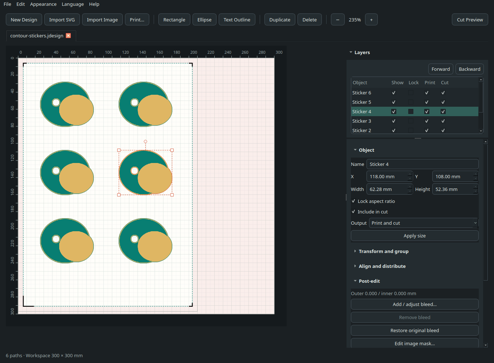

# Verona

**English** · [繁體中文](README.zh-TW.md)

An independent Linux workspace for **Siser Juliet**: import artwork, edit and
arrange a sheet, print at actual size, and send a cut over local Wi-Fi.
No account, subscription or cloud upload. Installation downloads dependencies;
normal editing and cutting work offline.

## Features

- **Artwork and paths:** import SVG vectors, raster images and PDF pages; draw
  shapes and text outlines; edit nodes, curves, masks and traced contours.
- **Layout and layers:** move, resize, rotate, mirror, group, align, distribute
  and automatically arrange artwork. Control visibility, locking, stacking
  order, printing and cutting per object.
- **Post-edit:** adjust outer bleed and inner fill on multiple existing images,
  extend edge colors or use a solid color, restore supported original LDS
  bleed, and edit individual image masks without reimporting.
- **Printing:** preview and print at 100% actual size, export PDF, configure
  Print & Cut marks, and apply measured alignment corrections.
- **Saved settings:** retain printer/media preferences and cut passes,
  speed, force and tool settings in designs. Printer preferences also have
  a local last-used fallback.
- **Workspace:** multiple document tabs, undo/redo, collapsible inspector
  sections, a toolbar that adapts to narrow windows, and wheel-safe dropdowns
  and numeric fields. English/Traditional Chinese and light/dark themes.
- **Desktop integration:** double-click designs into the existing workspace,
  reuse tabs for already-open files, and show LDS thumbnails in supported file managers.
- **Local tools:** a dry-run-first CLI, read-only cutter information,
  an optional MCP editor bridge, and experimental local firmware tools.

## Current support

Verona is **alpha software**. The supported cutting workspace is **300 × 300 mm**.

| Area | Status |
| --- | --- |
| Juliet over Wi-Fi | Cutting and Print & Cut have been used on real hardware. |
| USB-B cutting | Experimental. |
| Romeo | Untested; not a supported target. |
| LDS files | Supported content can be imported; saving is experimental and official Leonardo compatibility is unverified. |
| Camera and registration diagnostics | No verified camera-frame access or registration-failure diagnostic API. |
| Firmware updates | Experimental transfer tools; hardware installation, compatibility and recovery remain unverified. |

Automatic drag-knife offset compensation is not implemented. A successful
transfer does not confirm physical cutting completion.

## Install

Requires **Linux and Python 3.11+**. On Ubuntu/Mint, install missing system libraries:

~~~bash
sudo apt install git python3-venv libxcb-cursor0 libegl1 libopengl0 libxkbcommon0 libfontconfig1

git clone https://github.com/Hsi431/verona-cut.git
cd verona-cut
python3 -m venv .venv
. .venv/bin/activate
python -m pip install .
verona
~~~

Choose **Language** and **Appearance** from the menu, or launch directly in a language:

~~~bash
verona --lang en
verona --lang zh_TW
~~~

To enable desktop launchers, file associations and LDS thumbnails:

~~~bash
verona-desktop
~~~

This configures only the current user. Restart the file manager after the
first installation to reload thumbnailers; thumbnail support has been verified
with Nemo. Opening files through the desktop or `verona --open <file>` shares
the existing workspace.

### Update an existing installation

Save your work and close Verona, then run from the repository:

~~~bash
git pull --ff-only
. .venv/bin/activate
python -m pip install .
verona
~~~

Reinstalling is required after pulling changes when installed with `pip install .`.

## Everyday workflow

1. **Open or import.** Open `.lds` or `.jdesign` in a tab, or import artwork.
   Images can be **Print only**, **Cut only**, or **Print and cut**; change their
   output later while retaining the source image.
2. **Edit and arrange.** Adjust paths and layers, arrange copies, or select
   existing images and use **Post-edit → Add / adjust bleed…**.
3. **Set up the sheet.** Choose paper dimensions and, for Print & Cut, matching
   registration marks. Print-only sheets do not require registration marks.
4. **Print.** Use the toolbar button beside the import controls or `Ctrl+P`.
   Verona provides the preview; **Printer and media settings…** opens Qt's
   Linux print dialog with the installed printer driver's options.
5. **Review and cut.** Enter the cutter's displayed IPv4 address under
   **Connection**, check the connection, review tool/force/speed and
   **Cut passes** (1–10), then explicitly send the job.

Previewing or changing print settings does not submit a job. After successful
submission, printer/media preferences are remembered locally and included when
the design is saved. Saved document preferences take priority; paper dimensions
and orientation follow the design. An unavailable saved printer produces a notice.

Hidden layers are excluded from print and cut output; locked layers still
output but cannot be edited. Cuts are checked against the workspace and active
registration frame. Failed transfers are never automatically replayed.
A connection check reads a version; it does not establish machine readiness.

For a first cut, remove the blade holder or use a pen. Secure the material,
clear the travel area and choose force/speed for the material. Verona has no
verified remote emergency-stop command.

## Design files and settings

- **`.jdesign`:** Verona's editable design format.
- **`.lds`:** supported native artwork plus Verona editing data when saved.
  **Save design as…** (`Ctrl+Shift+S`) offers both formats. The first overwrite
  of an existing LDS preserves its original as `<filename>.lds.bak`.
- **Preferences:** print options, cut settings and layer state survive
  save/reopen in Verona. Other LDS readers may ignore Verona-specific data.
- **Native print output:** printed vector styles and bleed are rasterized at
  300 DPI in LDS output; their original sources stay editable in Verona.

Supported native LDS bleed is imported in millimetres. If an earlier Verona
save lost it, **Post-edit → Restore original bleed** can recover matching
settings from the original LDS or its backup. Recovery is undoable and retains
current artwork and layer edits. See [native bleed details](docs/NATIVE_BLEED.md).

## Command line

The CLI can validate and export a job without connecting to a cutter:

~~~bash
verona-cut cut examples/pen-calibration.jdesign --dry-run --output preview.plt
~~~

For read-only checks and an explicitly authorized cut:

~~~bash
read -r -p 'Cutter IPv4 address: ' VERONA_HOST
export VERONA_HOST
verona-cut status --host "$VERONA_HOST"
verona-cut status --host "$VERONA_HOST" --details

# Load a pen, check the setup, then send once.
verona-cut cut examples/pen-calibration.jdesign --host "$VERONA_HOST" --send
~~~

`cut` defaults to a dry run and accepts `.jdesign` or plain path-based SVG,
not arbitrary PLT input. Overrides: `--passes 1..10`, `--force 1..160`,
`--speed 1..13`, `--tool pen|blade`. These are machine settings, not material
recommendations. Each contour repeats before the next; Print & Cut registration
runs once per job. Omitting overrides preserves saved settings or the applicable
machine defaults.

The GUI and CLI accept `VERONA_HOST`; `--host` overrides it. TCP defaults to
port 8080, configurable with `--port`. There is no LAN scanning.

## Experimental firmware tools

Open **Help → Firmware update (experimental)…**, or inspect a local file offline:

~~~bash
verona-firmware inspect ./firmware.bin
~~~

Verona does not bundle or automatically download firmware. Format checks do
not establish hardware compatibility, and a completed transfer does not prove
installation. GUI attempts have local history with failure stages and known
byte counts. Read [the firmware workflow](docs/FIRMWARE_UPDATE.md) before use.

## Development and documentation

From the activated virtual environment:

~~~bash
python -m pip install -e '.[mcp]'
QT_QPA_PLATFORM=offscreen python -m unittest discover -s tests -v
python scripts/check-release.py
~~~

Tests use synthetic fixtures, mocks and local sockets; they do not operate
a cutter or submit real print jobs. Run the optional local MCP service with
`verona-mcp`; see the [operating guide](src/verona/agent-guide.md).

[Architecture](docs/ARCHITECTURE.md) · [Protocol](docs/PROTOCOL.md) ·
[Wi-Fi diagnostics](docs/WIFI_DIAGNOSTICS.md) · [Release workflow](docs/RELEASING.md)

## License and project status

Source code: [MIT](LICENSE). Dependencies retain their
[own licenses](THIRD_PARTY_NOTICES.md).

Verona is an independent, unofficial interoperability project. It is not
affiliated with, endorsed by or supported by Siser S.r.l. or Siser North America,
Inc. Siser, Juliet, Romeo and Leonardo Design Studio are trademarks of their
respective owners. Use at your own risk; the authors and contributors accept
no responsibility for hardware damage, voided warranties, ruined materials
or personal injury.
