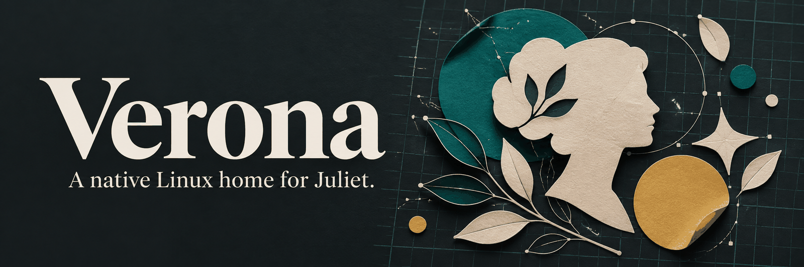
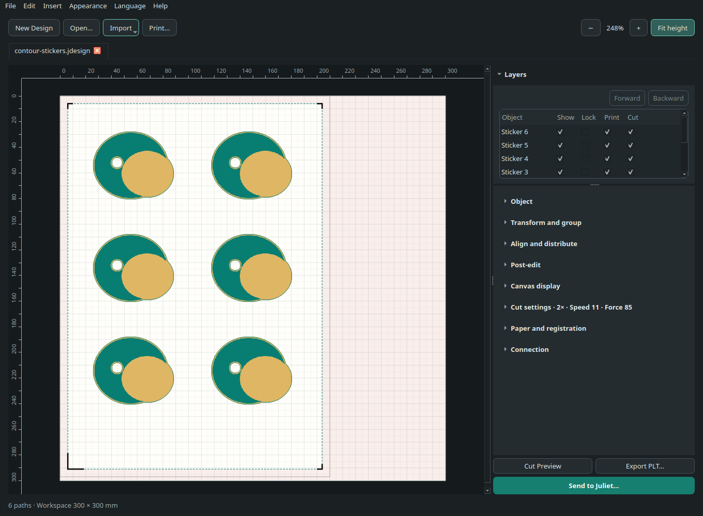
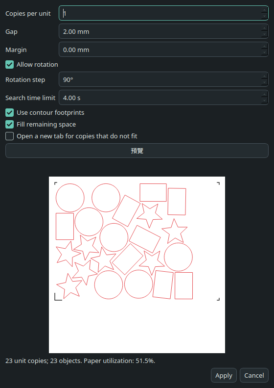

# Verona

**English** · [繁體中文](README.zh-TW.md)

An independent Linux desktop workspace for **Siser Juliet** owners. Import and
edit artwork, arrange a sheet, print at actual size, and send cut jobs over
local Wi-Fi from one application. No account, subscription, or cloud upload is
needed. Installation downloads dependencies; everyday editing and cutting work
offline.

## Features

- **Artwork and paths:** import SVG vectors, raster images and PDF pages; drop
  images into the workspace for an import preview; draw shapes, add editable
  text and turn it into outlines, edit nodes, curves and masks, and trace raster
  images into cutlines. Combine, subtract, intersect or exclude closed vector
  shapes. In the image preview, wheel to zoom around the pointer, middle-drag or
  Space+left-drag to pan, and **Fit** to reset the view.
- **Layout and layers:** move, resize, rotate, mirror, group, align, distribute
  and snap artwork to edges with smart or ruler guides. Control visibility,
  locking, stacking order, printing and cutting per object.
- **Automatic layout:** the built-in engine packs the selected artwork by its
  real outline at any angle, keeps clear of registration marks and anything else
  on the sheet, and gathers the leftover space so you can decide what to do with
  it. A progress bar runs while it works, and the preview lists any copies that
  did not fit. You can also fill the remaining space, or send copies that do not
  fit to new tabs (that option uses the legacy layout). The built-in engine
  supports Linux x86_64 with glibc 2.17 or newer; other platforms use the legacy
  layout.
- **Personalized batches:** preview CSV rows or pasted table data, then create batches
  of personalized text artwork from one design template.
- **Post-edit:** adjust outer bleed and inner fill on multiple existing images,
  extend edge colors or use a solid color, restore supported original LDS
  bleed, and edit individual image masks without reimporting. **Smooth cutlines…**
  previews the original against the result and applies a maximum millimetre offset
  to selected vector or image cutlines; the edit is undoable. Smoothing may reduce
  short segments and turns; no physical speed benchmark is available.
- **Paper and printing:** choose common or custom paper sizes and orientation;
  preview and print at 100% actual size, export PDF, configure Print & Cut
  marks, and apply measured alignment corrections. Choose driver media and
  quality when available, and optionally apply an ICC profile and rendering
  intent.
- **Saved settings:** retain printer/media preferences and cut passes,
  speed, force and tool settings in designs. Printer preferences also have
  a local last-used fallback.
- **Workspace:** multiple document tabs, undo/redo, collapsible inspector
  sections, and wheel-safe controls. Opening a design fits the page height;
  `Ctrl+0` fits it again. File/import tools are at the upper left; shapes and
  text are under **Insert**. Zoom controls are at the upper right, separate from
  the file tools. Fixed rulers along the workspace's top and left edges stay in
  place as the canvas scrolls, with ticks tracking the view. The bottom status
  strip is compact and shows Stop only while sending; cut preview/export/send
  are in the right panel. Ctrl/Alt+wheel zooms the main canvas around the
  pointer; Shift+wheel scrolls horizontally. Shift-drag constrains movement,
  Alt-drag duplicates, and Shift-rotation snaps to 15°. English/Traditional
  Chinese and light/dark themes.
- **Desktop integration:** double-click designs into the existing workspace,
  reuse tabs for already-open files, and show LDS thumbnails in supported file managers.
- **Local tools:** a dry-run-first CLI, read-only cutter information, and
  experimental local firmware tools. An optional MCP bridge lets compatible
  assistants inspect and edit the open design and prepare print or cut work;
  printing and sending remain explicit actions.

### Automatic recovery

The desktop workspace saves changed, unsaved tabs every 30 seconds under
`$XDG_STATE_HOME/verona/recovery` (default `~/.local/state/verona/recovery`).
Drafts stay on this computer and do not overwrite the original design.
After an unexpected exit, choose **Restore**, **Later** or **Discard drafts**.
Restored tabs are marked unsaved; save them normally to keep the recovered work.
Up to the last 30 seconds of editing may be missing. Undo history is not recovered.
Saving or discarding a tab removes its draft, and normal exit clears the current
workspace's drafts. Unreadable drafts are kept; a running workspace's drafts
are left alone.

### Material/tool presets

Expand **Cutting tool** in the right inspector and use **Save preset…** to name
the current tool, passes, speed, force and custom-speed/force toggle. Presets
live in the local `Verona/Workspace` user settings and can be reused across designs.
Choosing a preset does not change the document until you click **Apply**;
applying affects only the active tab and supports undo/redo. Connections, IP
addresses, paper and artwork stay unchanged, and applying never sends a job.
Replacing or deleting a preset asks for confirmation. No material values are
preloaded; save settings you have verified with your own test cuts.

## Current support

Verona is **alpha software**. The supported cutting workspace is **300 × 300 mm**.

| Area | Status |
| --- | --- |
| Juliet over Wi-Fi | Cutting and Print & Cut have been used on real hardware. |
| USB-B cutting | Experimental. |
| Romeo | Untested; not a supported target. |
| LDS files | Supported content can be imported; saving is experimental and official Leonardo compatibility is unverified. |
| Camera and registration diagnostics | No verified camera-frame access or registration-failure diagnostic API. |
| Firmware updates | Experimental transfer tools; hardware installation, compatibility and recovery remain unverified. |

Automatic drag-knife offset compensation is not implemented. A successful
transfer does not confirm physical cutting completion.

## Install

Requires **Linux and Python 3.11+**. On Ubuntu/Mint, install missing system libraries:

~~~bash
sudo apt install git python3-venv libxcb-cursor0 libegl1 libopengl0 libxkbcommon0 libfontconfig1

git clone https://github.com/Hsi431/verona-cut.git
cd verona-cut
./install.sh
./run.sh
~~~

Choose **Language** and **Appearance** from the menu, or launch with a language:

~~~bash
./run-en.sh
./run-zh-TW.sh
~~~

To enable desktop launchers, file associations and LDS thumbnails:

~~~bash
./.venv/bin/verona-desktop
~~~

This configures only the current user. Restart the file manager after the
first installation to reload thumbnailers; thumbnail support has been verified
with Nemo. Opening files through the desktop or `./.venv/bin/verona --open <file>` shares
the existing workspace.

### Update an existing installation

Save your work and close Verona, then run from the repository:

~~~bash
git pull --ff-only
./install.sh
./run.sh
~~~

Reinstall after pulling changes so Verona and the built-in layout engine update
together.

## Everyday workflow

1. **Open or import.** Open `.lds` or `.jdesign` in a tab; the page fits the
   workspace height. Press `Ctrl+0` to fit it again. Import artwork from the
   top controls, or drop one or more images into the workspace to open the import preview.
   In the preview, wheel to zoom around the pointer, middle-drag or Space+left-drag
   to pan, and choose **Fit** to reset the view. New image imports use 0.10 mm cutline
   smoothing by default (range 0–0.5 mm; 0 disables it); older designs are not changed
   automatically.
   Images can be **Print only**, **Cut only**, or **Print and cut**; change their
   output later while retaining the source image.
2. **Edit and arrange.** Add shapes and text outlines from **Insert**, adjust
   paths and layers, arrange copies, or select existing images and use
   **Post-edit → Add / adjust bleed…**. Use **Post-edit → Smooth cutlines…** to
   compare and apply a bounded smoothing edit to selected vector or image cutlines;
   undo restores the original paths.

3. **Set up the sheet.** Choose A4, A5, A6, B5, Letter, 4×6 in, 5×7 in, or
   custom dimensions and orientation. If a size moves registration marks beyond
   the sheet, Verona keeps their positions and shows how to adjust them.
4. **Print.** Use the toolbar button beside the import controls or `Ctrl+P`.
   Choose the printer, driver media/quality, color mode and copies beside the
   preview. ICC profiles and rendering intent are optional; **More printer
   settings…** opens Qt's Linux print dialog. If driver options cannot be read,
   use that system dialog instead.
5. **Review and cut.** Use the fixed controls at the bottom of the right panel
   for cut preview, PLT export or sending. Enter the cutter's displayed IPv4
   address under **Connection**, check the connection, review tool/force/speed
   and **Cut passes** (1–10), then explicitly send the job.

### Canvas shortcuts

Arrow keys move selected objects by 0.1 mm; Shift+arrows move 1 mm. Ctrl+C/X/V
copy, cut and paste; Ctrl+Shift+V pastes in place. Delete or Backspace removes
the selection. Ctrl+] / Ctrl+[ moves layers forward/backward; add Shift to move
to the front/back. Ctrl+= or Ctrl++ zooms in, Ctrl+- zooms out, Ctrl+1 shows 100%, and
Ctrl+0 fits page height. Esc or Ctrl+Shift+A deselects.

Previewing or changing print settings does not submit a job. Driver options are
sent with that print job and saved in the design; Verona does not change printer
defaults. ICC profile paths are kept in local settings by printer and media and
are not written into design files. Paper dimensions and orientation follow the
design. An unavailable saved printer produces a notice.

Hidden layers are excluded from print and cut output; locked layers still
output but cannot be edited. Cuts are checked against the workspace and active
registration frame. Failed transfers are never automatically replayed.
A connection check reads a version; it does not establish machine readiness.

During transfer, **Stop sending** stops further data from the computer. It
cannot withdraw data already received by the cutter or confirm that it has stopped.
To cancel a streaming job, stop sending in Verona before cancelling on the cutter.
Panel cancellation is not a verified way to stop the computer's upload.

For a first cut, remove the blade holder or use a pen. Secure the material,
clear the travel area and choose force/speed for the material. Verona has no
verified remote emergency-stop command.

## Design files and settings

- **`.jdesign`:** Verona's editable design format.
- **`.lds`:** imports supported single-layer CDOC vector, image and logo data;
  unsupported object classes or hidden/multiple layers are rejected rather
  than silently dropped. Saving adds Verona editing data, but remains
  experimental and official Leonardo compatibility is unverified.
  **Save design as…** (`Ctrl+Shift+S`) offers both formats. The first overwrite
  of an existing LDS preserves its original as `<filename>.lds.bak`.
- **Preferences:** print options, cut settings and layer state survive
  save/reopen in Verona. Other LDS readers may ignore Verona-specific data.
- **Native print output:** printed vector styles and bleed are rasterized at
  300 DPI in LDS output; their original sources stay editable in Verona.

Supported native LDS bleed is imported in millimetres. If an earlier Verona
save lost it, **Post-edit → Restore original bleed** can recover matching
settings from the original LDS or its backup. Recovery is undoable and retains
current artwork and layer edits. See [native bleed details](docs/NATIVE_BLEED.md).

## Command line

The CLI can validate and export a job without connecting to a cutter:

~~~bash
./.venv/bin/verona-cut cut examples/pen-calibration.jdesign --dry-run --output preview.plt
~~~

For read-only checks and an explicitly authorized cut:

~~~bash
read -r -p 'Cutter IPv4 address: ' VERONA_HOST
export VERONA_HOST
./.venv/bin/verona-cut status --host "$VERONA_HOST"
./.venv/bin/verona-cut status --host "$VERONA_HOST" --details

# Load a pen, check the setup, then send once.
./.venv/bin/verona-cut cut examples/pen-calibration.jdesign --host "$VERONA_HOST" --send
~~~

`cut` defaults to a dry run and accepts `.jdesign` or plain path-based SVG,
not arbitrary PLT input. Overrides: `--passes 1..10`, `--force 1..160`,
`--speed 1..13`, `--tool pen|blade`. These are machine settings, not material
recommendations. Each contour repeats before the next; Print & Cut registration
runs once per job. Omitting overrides preserves saved settings or the applicable
machine defaults.

The GUI and CLI accept `VERONA_HOST`; `--host` overrides it. TCP defaults to
port 8080, configurable with `--port`. There is no LAN scanning.

## Experimental firmware tools

Open **Help → Firmware update (experimental)…**, or inspect a local file offline:

~~~bash
read -r -p 'Local firmware file path: ' firmware_file
./.venv/bin/verona-firmware inspect "$firmware_file"
~~~

Verona does not bundle or automatically download firmware. Format checks do
not establish hardware compatibility, and a completed transfer does not prove
installation. GUI attempts have local history with failure stages and known
byte counts. Read [the firmware workflow](docs/FIRMWARE_UPDATE.md) before use.

## Development and documentation

From the activated virtual environment:

~~~bash
python -m pip install -e '.[mcp]'
QT_QPA_PLATFORM=offscreen python -m unittest discover -s tests -v
python scripts/check-release.py
~~~

Tests use synthetic fixtures, mocks and local sockets; they do not operate
a cutter or submit real print jobs. Run the optional local MCP service with
`./.venv/bin/verona-mcp`; see the [operating guide](src/verona/agent-guide.md).

[Architecture](docs/ARCHITECTURE.md) · [Protocol](docs/PROTOCOL.md) ·
[Wi-Fi diagnostics](docs/WIFI_DIAGNOSTICS.md) · [Release workflow](docs/RELEASING.md)

## License and project status

Source code: [MIT](LICENSE). Dependencies retain their
[own licenses](THIRD_PARTY_NOTICES.md).

Verona is an independent, unofficial interoperability project. It is not
affiliated with, endorsed by or supported by Siser S.r.l. or Siser North America,
Inc. Siser, Juliet, Romeo and Leonardo Design Studio are trademarks of their
respective owners. Use at your own risk; the authors and contributors accept
no responsibility for hardware damage, voided warranties, ruined materials
or personal injury.
