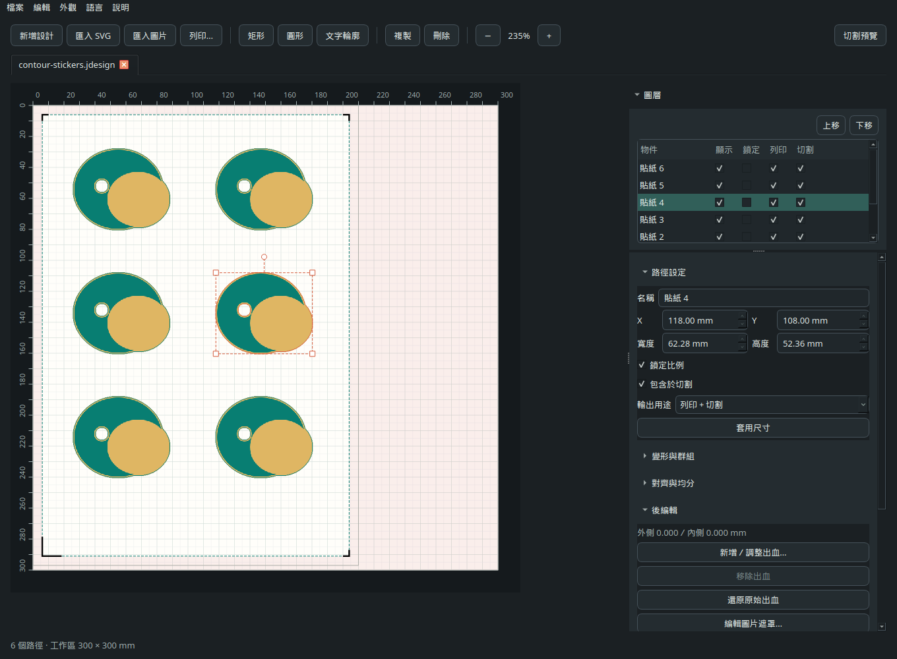

# Verona

[English](README.md) · **繁體中文**

為 **Siser Juliet** 打造的獨立 Linux 設計與切割程式。
從匯入圖稿、編輯排版、原尺寸列印，到透過區域網路 Wi-Fi 傳送切割工作，都能在同一個桌面程式完成。
不需帳號、訂閱或上傳雲端；安裝時會下載依賴套件，日常編輯與切割可離線使用。

## 功能

- **圖稿與路徑：** 匯入 SVG 向量、點陣圖片及 PDF 頁面；建立形狀與文字輪廓，編輯節點、曲線、遮罩與描邊輪廓。
- **排版與圖層：** 移動、縮放、旋轉、鏡射、群組、對齊、分散與自動排版；分別控制物件的顯示、鎖定、前後順序、列印與切割。
- **後編輯：** 不用重新匯入圖片，就能批次調整外側出血、內側補色、延伸邊緣色或使用單色出血，還原支援的原始 LDS 出血，或編輯單張圖片遮罩。
- **列印：** 100% 原尺寸預覽與列印、匯出 PDF、設定 Print & Cut 定位標記，以及依量測結果調整切割對位。
- **保存設定：** 設計檔保存印表機與紙材偏好，以及切割次數、速度、壓力和工具設定；本機也會記住上次使用的列印偏好。
- **工作介面：** 多文件分頁、復原／重做、可收合的右側區塊，以及適應窄視窗的工具列；下拉選單與數值欄位不會因滾動頁面而誤改。支援繁體中文、英文與亮暗主題。
- **桌面整合：** 雙擊檔案會交給既有工作視窗，已開啟的文件會切回原分頁；支援的檔案管理員可顯示 LDS 縮圖。
- **本機工具：** 預設試跑的 CLI、唯讀切割機資訊、選用的 MCP 編輯介面，以及實驗性本機韌體工具。

## 目前支援狀態

Verona 目前是 **Alpha 測試階段**，支援的切割工作區為 **300 × 300 mm**。

| 項目 | 狀態 |
| --- | --- |
| Juliet Wi-Fi | 已在實機使用一般切割與 Print & Cut。 |
| USB-B 切割 | 實驗性功能。 |
| Romeo | 未測試，目前不列為支援機型。 |
| LDS 檔案 | 可匯入支援的內容；儲存仍屬實驗性，尚未驗證原廠 Leonardo 相容性。 |
| 相機與辨識診斷 | 尚無經驗證的相機原始畫面讀取或定位失敗診斷 API。 |
| 韌體更新 | 提供實驗性傳輸工具；實機安裝、相容性與復原流程尚未驗證。 |

尚未實作自動拖刀刀尖偏移補償。傳輸成功不代表實體切割已完成。

## 安裝

需要 **Linux 與 Python 3.11 以上版本**。Ubuntu／Mint 若缺少系統依賴，可先安裝：

~~~bash
sudo apt install git python3-venv libxcb-cursor0 libegl1 libopengl0 libxkbcommon0 libfontconfig1

git clone https://github.com/Hsi431/verona-cut.git
cd verona-cut
python3 -m venv .venv
. .venv/bin/activate
python -m pip install .
verona
~~~

可從選單切換「語言」與「外觀」，也能直接指定啟動語言：

~~~bash
verona --lang zh_TW
verona --lang en
~~~

安裝桌面捷徑、檔案關聯與 LDS 縮圖：

~~~bash
verona-desktop
~~~

這只會調整目前使用者的桌面設定。首次安裝後請重新啟動檔案管理員，讓縮圖工具載入；
縮圖功能已在 Nemo 驗證。從桌面開啟檔案，或執行 `verona --open <file>`，會使用既有工作視窗。

### 更新既有安裝

先儲存工作並關閉 Verona，再到原始碼目錄執行：

~~~bash
git pull --ff-only
. .venv/bin/activate
python -m pip install .
verona
~~~

若原先使用 `pip install .` 安裝，拉取更新後仍需重新安裝，程式才會載入新版。

## 日常操作

1. **開啟或匯入：** 用分頁開啟 `.lds`、`.jdesign`，或匯入圖稿。
   圖片可選「僅列印」、「僅切割」或「列印＋切割」，之後仍能變更輸出用途並保留原始圖片。
2. **編輯與排版：** 調整路徑、圖層及排列；選取既有圖片後，使用「後編輯 → 新增／調整出血…」批次修改。
3. **設定紙張：** 選擇紙張尺寸；Print & Cut 使用與列印紙張相符的定位標記。純列印不需要定位標記。
4. **列印：** 點匯入按鈕旁的「列印」，或按 `Ctrl+P`。
   Verona 提供預覽；「印表機與紙材設定…」會開啟 Qt 的 Linux 列印對話框，顯示已安裝驅動提供的選項。
5. **檢查並切割：** 在「傳送連線」輸入機器螢幕顯示的 IPv4 位址並檢查連線，
   確認工具、壓力、速度與「切割次數」（1–10 次），再明確送出工作。

預覽或調整列印設定不會直接送印。成功送印後，印表機與紙材偏好會記在本機，儲存設計時也會寫入檔案。
設計內的偏好優先使用；紙張尺寸與方向依設計設定。若原印表機無法使用，預覽會顯示提醒。

隱藏圖層不會列印或切割；鎖定圖層仍會輸出，但不能編輯。
傳送前會檢查工作區與啟用的定位範圍，傳輸失敗不會自動重送。
連線檢查只會讀取版本，不代表機器已閒置或材料已就緒。

首次測試請取下刀座或使用筆，固定材料、清空移動範圍，並依材料設定壓力與速度。
Verona 尚無經驗證的遠端緊急停止指令。

## 設計檔與設定保存

- **`.jdesign`：** Verona 的可編輯設計格式。
- **`.lds`：** 儲存支援的原生圖稿及 Verona 編輯資料。
  「另存設計…」（`Ctrl+Shift+S`）可選兩種格式；第一次覆寫既有 LDS 時，
  會把原檔保留為 `<filename>.lds.bak`。
- **設定：** 列印偏好、切割設定與圖層狀態可在 Verona 儲存後重新開啟；
  其他 LDS 讀取程式可能忽略 Verona 的擴充資料。
- **原生列印輸出：** LDS 中的列印向量樣式與出血會以 300 DPI 點陣化輸出，
  原始來源仍可在 Verona 繼續編輯。

支援的原生 LDS 出血會以毫米匯入。若較早版本的 Verona 儲存時遺失了出血，
可用「後編輯 → 還原原始出血」從原始 LDS 或備份恢復相符的設定。
還原可復原，並保留目前的圖稿與圖層編輯。詳見[原生出血說明](docs/NATIVE_BLEED.md)。

## 命令列

不連接切割機，也能驗證並匯出工作：

~~~bash
verona-cut cut examples/pen-calibration.jdesign --dry-run --output preview.plt
~~~

唯讀查詢，以及確認就緒後明確傳送一次：

~~~bash
read -r -p 'Cutter IPv4 address: ' VERONA_HOST
export VERONA_HOST
verona-cut status --host "$VERONA_HOST"
verona-cut status --host "$VERONA_HOST" --details

# 裝好筆、確認設定與材料後，再傳送一次。
verona-cut cut examples/pen-calibration.jdesign --host "$VERONA_HOST" --send
~~~

`cut` 預設只試跑，接受 `.jdesign` 或單純路徑 SVG，不接受任意 PLT 指令。
可用 `--passes 1..10`、`--force 1..160`、`--speed 1..13`、
`--tool pen|blade` 覆寫設定；這些是機器設定值，並非材料建議。
每條輪廓完成指定次數後才處理下一條；Print & Cut 每份工作只進行一次定位。
未覆寫的項目保留設計設定，或使用適用的機器預設值。

GUI 與 CLI 都接受 `VERONA_HOST`，`--host` 優先於環境變數。
TCP 預設連接埠為 8080，可用 `--port` 變更；不會掃描區域網路。

## 實驗性韌體工具

開啟「說明 → 韌體更新（實驗功能）…」，或離線檢查本機檔案：

~~~bash
verona-firmware inspect ./firmware.bin
~~~

Verona 不附帶韌體，也不會自動下載。格式檢查不代表硬體相容，傳輸完成也不代表安裝成功。
GUI 嘗試會保存本機紀錄，包含失敗階段與已知傳送位元組數；使用前請閱讀[韌體操作說明](docs/FIRMWARE_UPDATE.md)。

## 開發與技術文件

在已啟用的虛擬環境中執行：

~~~bash
python -m pip install -e '.[mcp]'
QT_QPA_PLATFORM=offscreen python -m unittest discover -s tests -v
python scripts/check-release.py
~~~

測試使用合成資料、模擬物件與本機 socket，不會操作切割機或提交實際列印工作。
選用的本機 MCP 服務可用 `verona-mcp` 啟動；操作方式見[使用指南](src/verona/agent-guide.md)。

[架構](docs/ARCHITECTURE.md) · [協定](docs/PROTOCOL.md) ·
[Wi-Fi 診斷](docs/WIFI_DIAGNOSTICS.md) · [發布流程](docs/RELEASING.md)

## 授權與專案性質

原始碼採 [MIT 授權](LICENSE)；依賴套件保留[各自授權](THIRD_PARTY_NOTICES.md)。

Verona 是獨立、非官方的 Linux 互通性專案，與 Siser S.r.l.、Siser North America, Inc.
沒有隸屬、背書或支援關係。Siser、Juliet、Romeo 與 Leonardo Design Studio 為各持有者的商標。
使用風險由使用者自行承擔；作者與貢獻者不對硬體損壞、保固失效、材料損失或人身傷害負責。
