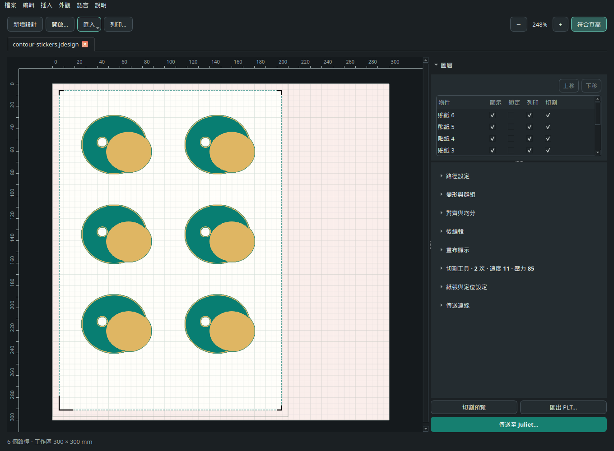
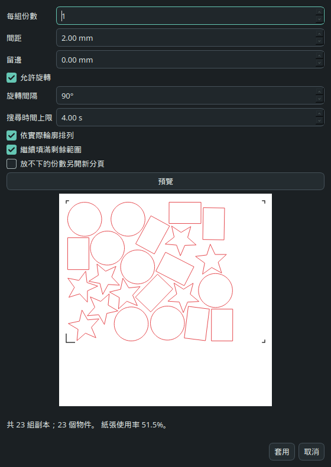

# Verona

[English](README.md) · **繁體中文**

給 **Siser Juliet** 使用者的獨立 Linux 桌面工作空間。在同一個程式裡就能匯入和編輯圖稿、排版、以原尺寸列印，再透過 Wi-Fi 把切割工作傳給機器。不需要帳號或訂閱，也不會上傳雲端；安裝時要下載相依套件，平常編輯和切割都能離線使用。

## 功能

- **圖稿與路徑：** 匯入 SVG 向量、點陣圖片及 PDF 頁面；可將圖片拖入工作區開啟匯入預覽；建立形狀、加入可編輯文字並轉成輪廓，編輯節點、曲線與遮罩，也能從點陣圖片描出刀線。封閉向量圖形可合併、相減、取交集或排除重疊部分。圖片預覽中可用滾輪以游標為中心縮放、中鍵或空白鍵＋左鍵拖曳平移，並按「符合視窗」重設檢視。
- **排版與圖層：** 移動、縮放、旋轉、鏡射、群組、對齊、分散，並用智慧參考線或尺標參考線貼齊邊緣。每個物件都能分別設定顯示、鎖定、前後順序、列印與切割。
- **自動排版：** 內建排版引擎會依實際輪廓、以任意角度把選取的物件排進紙張，避開定位標記和紙上其他物件，剩下的空位會盡量集中，留給你自己決定要不要再放東西。排版時有進度條，預覽會列出放不下的份數。也可以勾選填滿剩餘範圍，或把放不下的份數放到新分頁（這個選項使用舊版排法）。內建引擎支援 Linux x86_64、glibc 2.17 以上，其他平台使用舊版排法。
- **批次產生個人化圖稿：** 先預覽 CSV 或貼上的表格資料，再從同一份設計範本批次產生含個人化文字的圖稿。
- **後編輯：** 不用重新匯入圖片，就能批次調整外側出血、內側補色、延伸邊緣色或使用單色出血，還原支援的原始 LDS 出血，或編輯單張圖片遮罩。「平滑切割線…」可比較原線與結果，設定最大偏移（毫米）後套用到所選的向量或圖片切線，也能復原。平滑後短線段和轉折可能變少，但實際切割速度有沒有變快還沒測過。
- **紙張與列印：** 選擇常用或自訂紙張尺寸與方向；以 100% 原尺寸預覽和列印、匯出 PDF、設定 Print & Cut 定位標記，並依量測結果調整對位。驅動程式有提供時，可選紙材與品質；也能選用 ICC 描述檔及演算意圖。
- **保存設定：** 設計檔保存印表機與紙材偏好，以及切割次數、速度、壓力和工具設定；本機也會記住上次使用的列印偏好。
- **工作介面：** 多文件分頁、復原／重做、可收合的右側區塊；滾輪不會誤改下拉選單或數值欄位。開啟設計時會縮放到紙張高度，按 `Ctrl+0` 可再縮放一次。檔案與匯入工具在左上方，縮放在右上方，與檔案工具分開；尺標固定於工作區上方與左側，不隨畫布捲動，刻度會跟隨視圖更新。底部狀態列保持精簡，只有傳送時顯示停止按鈕；切割預覽、匯出與傳送位於右側面板。主畫布按住 Ctrl／Alt 滾輪可依游標位置縮放，Shift 滾輪水平捲動；Shift 拖曳可限制移動方向，Alt 拖曳可複製，按住 Shift 旋轉會以 15° 為間隔。支援繁體中文、英文與亮暗主題。
- **桌面整合：** 雙擊檔案會交給既有工作視窗，已開啟的文件會切回原分頁；支援的檔案管理員可顯示 LDS 縮圖。
- **本機工具：** 預設只試跑、不實際送出的 CLI，唯讀的切割機資訊，以及實驗性的本機韌體工具。選用的 MCP 協作介面可以讓相容的 AI 助理查看、編輯目前開啟的設計，並準備列印或切割工作；真正送印和傳送都要明確下指令。

### 自動復原

桌面工作區每 30 秒保存有變更且未儲存的分頁，位置為
`$XDG_STATE_HOME/verona/recovery`（預設 `~/.local/state/verona/recovery`）。
草稿只留在本機，不會覆寫原始設計。意外關閉後重開，可選擇「復原設計」、
「稍後再說」或「捨棄草稿」。復原的分頁會標記為未儲存，請照平常方式儲存。
最後最多 30 秒的編輯可能尚未寫入；復原／重做歷史不會保存。
儲存或捨棄分頁會移除對應草稿，正常離開會清除本次工作區草稿。
無法讀取的草稿會保留，仍在執行的其他工作區草稿不會被動到。

### 材料／刀具預設

在右側「切割工具」展開區塊，按「儲存預設…」替目前參數命名。
預設包含工具、切割次數、速度、壓力，以及「指定速度與壓力」開關，
保存在本機的 `Verona/Workspace` 使用者設定中，可跨設計重複使用。
選好預設後按「套用」才會變更目前分頁；可用復原／重做還原。
套用不會變更連線方式、IP、紙張或圖稿，也不會直接送出切割工作。
同名覆寫與刪除都會先確認。沒有內建材料數值，請保存自己試切確認的參數。

## 目前支援狀態

Verona 目前是 **Alpha 測試階段**，支援的切割工作區為 **300 × 300 mm**。

| 項目 | 狀態 |
| --- | --- |
| Juliet Wi-Fi | 已在實機使用一般切割與 Print & Cut。 |
| USB-B 切割 | 實驗性功能。 |
| Romeo | 未測試，目前不列為支援機型。 |
| LDS 檔案 | 可匯入支援的內容；儲存仍屬實驗性，尚未驗證原廠 Leonardo 相容性。 |
| 相機與辨識診斷 | 尚無經驗證的相機原始畫面讀取或定位失敗診斷 API。 |
| 韌體更新 | 提供實驗性傳輸工具；實機安裝、相容性與復原流程尚未驗證。 |

尚未實作自動拖刀刀尖偏移補償。傳輸成功不代表實體切割已完成。

## 安裝

需要 **Linux 與 Python 3.11 以上版本**。Ubuntu／Mint 若缺少系統套件，可先安裝：

~~~bash
sudo apt install git python3-venv libxcb-cursor0 libegl1 libopengl0 libxkbcommon0 libfontconfig1

git clone https://github.com/Hsi431/verona-cut.git
cd verona-cut
./install.sh
./run.sh
~~~

可從選單切換「語言」與「外觀」，也能用啟動腳本指定介面語言：

~~~bash
./run-zh-TW.sh
./run-en.sh
~~~

安裝桌面捷徑、檔案關聯與 LDS 縮圖：

~~~bash
./.venv/bin/verona-desktop
~~~

這只會調整目前使用者的桌面設定。首次安裝後請重新啟動檔案管理員，讓縮圖工具載入；
縮圖功能已在 Nemo 驗證。從桌面開啟檔案，或執行 `./.venv/bin/verona --open <file>`，會使用既有工作視窗。

### 更新既有安裝

先儲存工作並關閉 Verona，再到原始碼目錄執行：

~~~bash
git pull --ff-only
./install.sh
./run.sh
~~~

更新程式碼後要重新安裝，Verona 和內建排版引擎才會一起更新。

## 日常操作

1. **開啟或匯入：** 用分頁開啟 `.lds`、`.jdesign`，紙張會縮放到工作區高度，
   按 `Ctrl+0` 可再縮放一次。從頂部匯入圖稿，或將一張／多張圖片拖入工作區，開啟匯入預覽。
   預覽中可用滾輪以游標為中心縮放、中鍵或空白鍵＋左鍵拖曳平移，並按「符合視窗」重設檢視。新匯入圖片的刀線平滑預設為 0.10 mm（範圍 0–0.5 mm；設為 0 可停用）；舊設計不會自動變更。
   圖片可選「僅列印」、「僅切割」或「列印＋切割」，之後仍能變更輸出用途並保留原始圖片。
2. **編輯與排版：** 從「插入」選單新增形狀與文字輪廓，再調整路徑、圖層及排列；
   選取既有圖片後，使用「後編輯 → 新增／調整出血…」批次修改；「後編輯 → 平滑切割線…」可比較原線並套用受限平滑，復原可還原原路徑。

3. **設定紙張：** 選擇 A4、A5、A6、B5、Letter、4×6 in、5×7 in 或自訂尺寸與方向。若定位標記超出紙張，Verona 會保留原位置並提示調整方式。
4. **列印：** 點匯入按鈕旁的「列印」，或按 `Ctrl+P`。
   在預覽旁選擇印表機、驅動紙材／品質、色彩與份數。可選 ICC 描述檔與演算意圖；「更多印表機設定…」會開啟 Qt 的 Linux 列印對話框。若無法讀取驅動選項，請使用系統對話框。
5. **檢查並切割：** 使用右側面板下方固定的切割預覽、PLT 匯出或傳送控制。
   在「傳送連線」輸入機器螢幕顯示的 IPv4 位址並檢查連線，
   確認工具、壓力、速度與「切割次數」（1–10 次），再明確送出工作。

### 畫布快捷鍵

方向鍵每次移動 0.1 mm，Shift+方向鍵移動 1 mm。Ctrl+C／X／V 複製、剪下、貼上；Ctrl+Shift+V 原位貼上。Delete 或 Backspace 刪除選取物件。Ctrl+]／Ctrl+[ 上移／下移一層，加 Shift 則移至最上／最下層。Ctrl+= 或 Ctrl++ 放大、Ctrl+- 縮小、Ctrl+1 顯示 100%、Ctrl+0 縮放到頁高。Esc 或 Ctrl+Shift+A 取消選取。

預覽或調整列印設定不會直接送印。驅動選項只會隨該次工作送出，並儲存在設計檔；Verona 不會變更印表機預設值。ICC 描述檔路徑依印表機與紙材存在本機設定，不會寫入設計檔。紙張尺寸與方向依設計設定；若原印表機無法使用，預覽會顯示提醒。

隱藏圖層不會列印或切割；鎖定圖層仍會輸出，但不能編輯。
傳送前會檢查工作區與啟用的定位範圍，傳輸失敗不會自動重送。
連線檢查只會讀取版本，不代表機器已閒置或材料已就緒。

傳輸期間可按「停止傳送」中止電腦後續送出的資料；這不能撤回機器已收到的資料，也不代表機器已停止動作。
要取消仍在傳輸的工作，請先在 Verona 按「停止傳送」，再在機器端取消；目前不能依賴面板取消來中止電腦上傳。

首次測試請取下刀座或使用筆，固定材料、清空移動範圍，並依材料設定壓力與速度。
Verona 尚無經驗證的遠端緊急停止指令。

## 設計檔與設定保存

- **`.jdesign`：** Verona 的可編輯設計格式。
- **`.lds`：** 可匯入支援的單圖層 CDOC 向量、圖片與標誌物件；遇到不支援的物件類型或隱藏／多重圖層時會拒絕匯入，不會直接略過。儲存時會加入 Verona 編輯資料，但仍屬實驗性，尚未驗證與 Leonardo 的官方相容性。
  「另存設計…」（`Ctrl+Shift+S`）可選兩種格式；第一次覆寫既有 LDS 時，
  會把原檔保留為 `<filename>.lds.bak`。
- **設定：** 列印偏好、切割設定與圖層狀態可在 Verona 儲存後重新開啟；
  其他 LDS 讀取程式可能忽略 Verona 的擴充資料。
- **原生列印輸出：** LDS 中的列印向量樣式與出血會以 300 DPI 點陣化輸出，
  原始來源仍可在 Verona 繼續編輯。

支援的原生 LDS 出血會以毫米匯入。若較早版本的 Verona 儲存時遺失了出血，
可用「後編輯 → 還原原始出血」從原始 LDS 或備份恢復相符的設定。
還原可復原，並保留目前的圖稿與圖層編輯。詳見[原生出血說明](docs/NATIVE_BLEED.md)。

## 命令列

不連接切割機，也能驗證並匯出工作：

~~~bash
./.venv/bin/verona-cut cut examples/pen-calibration.jdesign --dry-run --output preview.plt
~~~

唯讀查詢，以及確認就緒後明確傳送一次：

~~~bash
read -r -p 'Cutter IPv4 address: ' VERONA_HOST
export VERONA_HOST
./.venv/bin/verona-cut status --host "$VERONA_HOST"
./.venv/bin/verona-cut status --host "$VERONA_HOST" --details

# 裝好筆、確認設定與材料後，再傳送一次。
./.venv/bin/verona-cut cut examples/pen-calibration.jdesign --host "$VERONA_HOST" --send
~~~

`cut` 預設只試跑，接受 `.jdesign` 或單純路徑 SVG，不接受任意 PLT 指令。
可用 `--passes 1..10`、`--force 1..160`、`--speed 1..13`、
`--tool pen|blade` 覆寫設定；這些是機器設定值，並非材料建議。
每條輪廓完成指定次數後才處理下一條；Print & Cut 每份工作只進行一次定位。
未覆寫的項目保留設計設定，或使用適用的機器預設值。

GUI 與 CLI 都接受 `VERONA_HOST`，`--host` 優先於環境變數。
TCP 預設連接埠為 8080，可用 `--port` 變更；不會掃描區域網路。

## 實驗性韌體工具

開啟「說明 → 韌體更新（實驗功能）…」，或離線檢查本機檔案：

~~~bash
read -r -p '韌體檔案路徑: ' firmware_file
./.venv/bin/verona-firmware inspect "$firmware_file"
~~~

Verona 不附帶韌體，也不會自動下載。格式檢查不代表硬體相容，傳輸完成也不代表安裝成功。
GUI 嘗試會保存本機紀錄，包含失敗階段與已知傳送位元組數；使用前請閱讀[韌體操作說明](docs/FIRMWARE_UPDATE.md)。

## 開發與技術文件

在已啟用的虛擬環境中執行：

~~~bash
python -m pip install -e '.[mcp]'
QT_QPA_PLATFORM=offscreen python -m unittest discover -s tests -v
python scripts/check-release.py
~~~

測試使用合成資料、模擬物件與本機 socket，不會操作切割機或提交實際列印工作。
選用的本機 MCP 服務可用 `./.venv/bin/verona-mcp` 啟動；操作方式見[使用指南](src/verona/agent-guide.md)。

[架構](docs/ARCHITECTURE.md) · [協定](docs/PROTOCOL.md) ·
[Wi-Fi 診斷](docs/WIFI_DIAGNOSTICS.md) · [發布流程](docs/RELEASING.md)

## 授權與專案性質

原始碼採 [MIT 授權](LICENSE)；相依套件保留[各自授權](THIRD_PARTY_NOTICES.md)。

Verona 是獨立、非官方的 Linux 互通性專案，與 Siser S.r.l.、Siser North America, Inc.
沒有隸屬、背書或支援關係。Siser、Juliet、Romeo 與 Leonardo Design Studio 為各持有者的商標。
使用風險由使用者自行承擔；作者與貢獻者不對硬體損壞、保固失效、材料損失或人身傷害負責。
